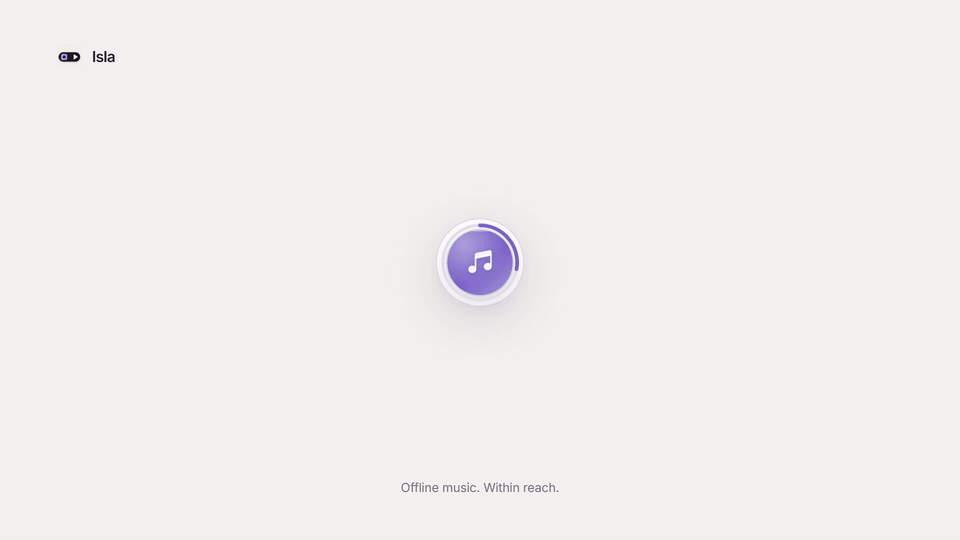

<p align="center">
  
</p>
<h1 align="center">Isla</h1>
<p align="center"><strong>Your music, within reach.</strong><br>A floating offline music player with fluid, artwork-centered motion.</p>
<p align="center">
  <a href="https://kuro-usagi-labs.github.io/Isla/">Watch the showcase</a> ·
  <a href="https://github.com/kuro-usagi-labs/Isla/releases/latest">Download Isla</a> ·
  <a href="CHANGELOG.md">Changelog</a>
</p>

[](https://kuro-usagi-labs.github.io/Isla/)

**Small on your desktop. Full control when you need it.**

- **An island for your music.** Circular artwork and progress, a separate playback pill, and a focused Now Playing view. Springs carry the shell and its contents through every transition.
- **Your sound.** Ten-band equalizer, eleven presets, preamp and a saved custom curve. Optional pulse responds to decoded audio.
- **Offline, on purpose.** Import local files, build playlists, save favorites and manage your queue. No account or streaming subscription.
- **Made to settle in.** Light/dark/system themes, artwork accents, reduced motion, crossfade and automatic return to the compact artwork.

## Download

Get installers from [GitHub Releases](https://github.com/kuro-usagi-labs/Isla/releases/latest).

| Platform | Download | Status |
| --- | --- | --- |
| Windows x64 | NSIS `.exe` installer | Primary tested platform; WebView2 required |
| macOS Apple Silicon / Intel | `.dmg` for your architecture | Experimental; ad-hoc signed, not notarized |
| Linux x64 | `.deb` / `.AppImage` | Experimental; desktop integration varies |

Unsigned builds can trigger operating-system prompts. macOS/Linux binaries are compiled by native GitHub runners; real-device audio and window-manager behavior still need broader testing. Startup integration is currently Windows-only.

## A few gestures

Click the artwork to reveal or hide playback controls. Use the expand icon to open Now Playing. Scroll over the floating pill for volume. Drag to move it. Open **EQ**, **Up Next**, or **Library** from the expanded player; **Escape** works back through the open layers.

## Build it

Node.js 24+, pnpm 12.18.0, Rust stable and the [Tauri platform prerequisites](https://v2.tauri.app/start/prerequisites/) are required.

```sh
pnpm install --frozen-lockfile
pnpm test
pnpm tauri dev
# Native installer for the current operating system:
pnpm tauri build
```

The Windows build uses NSIS. macOS builds require Xcode tools; Linux needs WebKitGTK 4.1, GTK/AppIndicator and ALSA development libraries. See [release automation](.github/workflows/release.yml) for the exact runner setup and [release notes](docs/releases/v1.0.1.md) for known limitations.

The [playback performance audit](docs/performance/2026-11-12-playback.md) documents the latest audio changes, measurements, reproducible native probes and testing limits.

## The showcase

The [editable launch film](media/showcase/) combines camera direction and rendering adapted from [Barty-Bart/motion-graphics](https://github.com/Barty-Bart/motion-graphics) with [Motion](https://github.com/motiondivision/motion) springs. The production React UI and geometry animate through split, merge, expand, EQ, seek, volume and theme changes. A damped camera follows the interactions through macro shots, pans and pull-backs. The finished film is 1080p at 60 fps with shutter sampling, an original score and CC0 interaction sounds. [Hyperframes](https://github.com/heygen-com/hyperframes) provides the editable timeline preview and checks.

```sh
pnpm build
pnpm showcase:build
pnpm showcase:preview
# FFmpeg and ffprobe must be available on PATH:
pnpm showcase:check
pnpm showcase:draft
pnpm showcase:render
pnpm showcase:package
```

Built with Tauri 2, Rust, React, TypeScript, Motion, Rodio/CPAL and SQLite. Local music stays local.
